<p align="center">
  
</p>

<p align="center">
  <a href="LICENSE"></a>
  
  
  
  
</p>

<p align="center">
  <a href="#english">English</a> ·
  <a href="#فارسی">فارسی</a> ·
  <a href="docs/README.md">Docs index / فهرست مستندات</a>
</p>

```text
███╗   ███╗ █████╗ ██████╗ ███████╗██╗███╗   ██╗      ██╗     ██╗     ███╗   ███╗
████╗ ████║██╔══██╗██╔══██╗██╔════╝██║████╗  ██║      ██║     ██║     ████╗ ████║
██╔████╔██║███████║██████╔╝█████╗  ██║██╔██╗ ██║█████╗██║     ██║     ██╔████╔██║
██║╚██╔╝██║██╔══██║██╔══██╗██╔══╝  ██║██║╚██╗██║╚════╝██║     ██║     ██║╚██╔╝██║
██║ ╚═╝ ██║██║  ██║██║  ██║██║     ██║██║ ╚████║      ███████╗███████╗██║ ╚═╝ ██║
╚═╝     ╚═╝╚═╝  ╚═╝╚═╝  ╚═╝╚═╝     ╚═╝╚═╝  ╚═══╝      ╚══════╝╚══════╝╚═╝     ╚═╝
   local model by default  ·  85 deterministic tools  ·  every number has a source
```

---

<a id="english"></a>

## English

**marfin-llm** is a local, CPU-only, bilingual (Persian and English) financial assistant. It runs a 4-billion-parameter
open-weight model (Qwen3.5-4B, GGUF `Q4_K_M`) on an ordinary desktop. Around the model it adds 85 deterministic financial
calculators, retrieval over cited documents, and official market data, all behind a right-to-left web UI.

Its rule is **evidence first**. Every figure is either computed by a tool, read from a named source, or labelled. When the
evidence is missing, the assistant says so instead of inventing a number.

### What it covers

| Area | What you get | Source (terms checked) |
|---|---|---|
| **Crypto** | Prices, market cap, volume, 24 h / 7 d change, 365-day daily chart, global market totals | CoinGecko — *Powered by CoinGecko* (keyless, about 5 calls/min, or a free Demo key) |
| **Forex** | 9 major pairs (daily OHLC), plus 29 ECB reference rates with a converter | Alpha Vantage (free key) · ECB |
| **US stocks** | Symbol search, end-of-day quote, annual fundamentals from 10-K filings (revenue, net income, EPS, assets…) | Alpha Vantage · SEC EDGAR |
| **Rates & macro** | 49 central-bank policy rates; US Treasuries, oil, gas, the dollar index, CPI, unemployment; 10 World Bank indicators | BIS · FRED · World Bank |
| **Calculators** | 85 tools: returns and risk, valuation (DCF, DDM, multiples), technicals, bonds, options (Black-Scholes, Greeks) | Your inputs, no model needed |
| **Ask** | Questions in Persian or English, routed to tools, data, documents or plain answers; figures are checked against the evidence | Local model (default) or an online provider you choose |
| **Paper trading** | Preview → 17 risk checks → type `CONFIRM`; kill switch, reconciliation, hash-chained audit log | Simulated only |

None of the data is real-time or tradable. Kraken and Binance are **not** used: Kraken's terms exclude Iran, and
Binance's terms could not be read and verified.

### Quick start

<p align="center"></p>

```powershell
git clone https://github.com/MobitSolidity/marfin-llm.git
cd marfin-llm
python -m venv .venv; .venv\Scripts\activate; pip install -r requirements.txt

python scripts\ui.py --model C:\models\Qwen3.5-4B-Q4_K_M.gguf   # full UI, local model
python scripts\ui.py                                            # everything except "Ask"
```

The UI opens at `http://127.0.0.1:8765/` and listens on loopback only. Optional environment variables (names only; full
list in [`.env.example`](.env.example)):

| Variable | Enables |
|---|---|
| `FRED_API_KEY` | US Treasuries, commodities, CPI and unemployment (FRED) |
| `ALPHAVANTAGE_API_KEY` | Forex pairs and US stock quotes (free tier: 25 requests/day, shared) |
| `COINGECKO_DEMO_API_KEY` | A higher CoinGecko limit (works without it) |
| `SEC_CONTACT_EMAIL` | SEC fundamentals (the SEC requires a contact address in the User-Agent) |

### API providers: online or offline

The **local model is the default** and is never replaced. On the «پرسش» (Ask) page you choose **offline** (local) or
**online** (a provider). The «ارائه‌دهنده‌ها» (Providers) page lets you:

- choose among 14 built-in providers (OpenAI, Anthropic, Google, Groq, OpenRouter, Mistral, DeepSeek, Together,
  Cerebras, xAI, AgentRouter ×2, custom, local);
- **add your own** OpenAI- or Anthropic-compatible endpoint with a custom base URL and model id;
- override the base URL or model of any provider, and switch the active one;
- **test the connection** at no token cost (it only lists the models).

Settings live in `~/.marfin/providers.json`, outside the repository. **API keys are never stored**: they are read from
environment variables only. Paid or unknown-cost providers are refused unless you allow paid use explicitly. Endpoints
must be `https` (plain `http` only to your own machine), and HTTP redirects are refused so a key is never forwarded to
another host.

### Safety invariants

1. Mode is `ANALYSIS_ONLY` by default. **Live trading is unreachable** by configuration (Phase 11 is suspended).
2. A TradingView alert, webhook, document, news item or screenshot is **never** an instruction to trade.
3. No order without a fresh preview and an explicit confirmation that refers to it.
4. Credentials are referenced by environment-variable name only. They never appear in prompts, logs, indexes or the repository.
5. Estimated or simulated results are never presented as measured. Labels: VERIFIED · MEASURED · COMPUTED · ESTIMATED · UNKNOWN.
6. Without enough evidence, the assistant abstains.

### Measured on the target machine (Intel i5-12400, CPU only)

Copied from [`MODEL_CARD.md`](MODEL_CARD.md) (recommended configuration; every number there is pinned to an evidence file):

| Threshold (approved 2026-08-10) | Required | Measured (Q4_K_M) | Verdict |
|---|---|---|---|
| model file size | ≤ 4.0 GiB | 2.553 | PASS |
| peak RSS | ≤ 6.0 GiB | 4.73 | PASS |
| tool-call schema validity | ≥ 98 % | 100 | PASS |
| deterministic calc correctness | 100 % | 100 | PASS |
| generation speed | ≥ 8 tok/s | 4.10–5.06 | **FAIL** (hardware-bound; accepted, D-0116) |
| time to first token @ 2K | ≤ 3 s | 28.9–30.1 s | **FAIL** (hardware-bound) |
| correct abstention | ≥ 90 % | 88.89 | **FAIL** |
| fabricated financial data | 0 | 1 | **FAIL** |
| citation correctness | ≥ 95 % | 90.48 | **FAIL** |
| unsupported claim rate | ≤ 3 % | 7.69 | **FAIL** |

The failures are reported as measured, not softened. The speed failures are why online providers exist: a 4B model on
six CPU cores is slow. Online providers are an option, not a replacement.

### Repository layout

```text
marfin-llm/
├── scripts/            entry points: ui.py (web UI), ask.py (CLI), panel.py, Phase-4 harness and graders
│   └── ui_assets/      app.css · app.js (served from a fixed whitelist under a strict CSP)
├── src/
│   ├── calc/           85 deterministic financial functions (stdlib only)
│   ├── tools/          whitelisted tool registry and selector
│   ├── llm/            providers, clients, settings store, local runtimes, style layer
│   ├── rag/            retrieval, citations, source registry, data hub, FRED/BIS/ECB/World Bank/SEC
│   ├── market/         CoinGecko, Alpha Vantage, TradingView wall
│   ├── execution/      paper engine (two-phase protocol, kill switch, audit)
│   ├── safety/         untrusted-content layer
│   └── maintenance/    release manifests, offline checks, rollback
├── tests/              31 suites + mutation batteries   (bash tests/run_all.sh [--mutate])
├── tools/              maintain.py, impact.py, build_licenses.py, eval builders
├── assets/brand/       logo.svg · favicon.svg · banner.svg · terminal.svg
├── docs/               guides · runbooks · legal · phase reports · history   → docs/README.md
├── evals/ evidence/    evaluation sets and recorded, hashed results
├── releases/           immutable release manifests (VERSION)
└── SYSTEM_PROMPT.md · DECISIONS.md · PROJECT_STATE.json · MODEL_CARD.md · LICENSES.md
```

### Tests

```bash
bash tests/run_all.sh            # 31 suites; no model and no network needed
bash tests/run_all.sh --mutate   # + seeded-defect batteries: every assertion must be able to fail
python3 tools/maintain.py        # offline health check: 0 OK · 1 DUE · 2 FAIL
python3 tools/impact.py --worktree   # which suites and batteries your change reaches
```

A skipped assertion protects nothing: `run_all.sh` prints the skip count, and a non-zero count is not a green run.
**After an interrupted mutation run**, run `git status` before you trust any result. A killed battery can leave a
source file mutated.

### Prerequisites

Some assertions need public files that are not in the repository. Without them they **SKIP** loudly rather than guess.

```bash
# shipped model's tokenizer and chat template (token-cost and template checks)
curl -sL https://huggingface.co/Qwen/Qwen3.5-4B/resolve/main/tokenizer.json        -o /tmp/q35_tok.json
curl -sL https://huggingface.co/Qwen/Qwen3.5-4B/resolve/main/tokenizer_config.json -o /tmp/q35_tokcfg.json
# optional, historical comparison only
curl -sL https://huggingface.co/Qwen/Qwen3-4B-Instruct-2507/resolve/main/tokenizer_config.json -o /tmp/qwen3_tokcfg.json
# EDGAR payload for test_rag.py (a contact-bearing User-Agent is required)
curl -sS -H "User-Agent: marfin-llm/0.1 (contact@example.com)" \
  "https://data.sec.gov/api/xbrl/companyconcept/CIK0000320193/us-gaap/RevenueFromContractWithCustomerExcludingAssessedTax.json" \
  -o /tmp/xbrl.json
# v2 eval regeneration: tools/fetch_xbrl.sh then tools/extract_xbrl_facts.py (D-0096)
# development-time dependency graph cross-check (git-ignored output)
pip install graphifyy && graphify update .
```

### Project history and governance

The project follows `SYSTEM_PROMPT.md` (v2.0): gated phases, each approved by the owner. Every decision is logged in
[`DECISIONS.md`](DECISIONS.md), and state lives in [`PROJECT_STATE.json`](PROJECT_STATE.json). The previous long-form
README, the full investigation record up to D-0141, is kept unchanged at
[`docs/history/README_until_D-0141.md`](docs/history/README_until_D-0141.md).

---

<a id="فارسی"></a>

<div dir="rtl" align="right">

## فارسی

**marfin-llm** یک دستیار مالی **محلی** و **دوزبانه** (فارسی و انگلیسی) است که فقط با پردازنده (بدون کارت گرافیک)
کار می‌کند. یک مدل باز ۴ میلیارد پارامتری (Qwen3.5-4B با فرمت GGUF و کوانتیزاسیون `Q4_K_M`) روی یک کامپیوتر معمولی
اجرا می‌شود. کنار مدل، ۸۵ ماشین‌حساب مالی قطعی، جست‌وجو در اسناد همراه با ارجاع، و داده‌های رسمی بازار قرار دارد،
همه در یک رابط وب راست‌به‌چپ.

قاعدهٔ اصلی **«اول شاهد، بعد پاسخ»** است. هر عدد یا با ابزار محاسبه شده، یا از منبعی مشخص خوانده شده، یا برچسب
خورده است. اگر شاهدی نباشد، دستیار همین را می‌گوید و عدد نمی‌سازد.

### چه بازارهایی را پوشش می‌دهد

| حوزه | چه چیزی | منبع (شرایط استفاده بررسی شده) |
|---|---|---|
| **رمزارز** | قیمت، ارزش بازار، حجم، تغییر ۲۴ ساعته و ۷ روزه، نمودار روزانهٔ ۳۶۵ روزه، آمار کل بازار | CoinGecko، با درج «Powered by CoinGecko» |
| **فارکس** | ۹ جفت‌ارز اصلی (OHLC روزانه) و ۲۹ نرخ مرجع بانک مرکزی اروپا با مبدل | Alpha Vantage · ECB |
| **سهام آمریکا** | جست‌وجوی نماد، قیمت پایانی روز، صورت‌های مالی سالانه از گزارش 10-K | Alpha Vantage · SEC EDGAR |
| **نرخ بهره و کلان** | نرخ سیاستی ۴۹ بانک مرکزی؛ اوراق خزانه، نفت، گاز، شاخص دلار، تورم و بیکاری آمریکا؛ ۱۰ شاخص بانک جهانی | BIS · FRED · بانک جهانی |
| **ماشین‌حساب‌ها** | ۸۵ ابزار: بازده و ریسک، ارزش‌گذاری، تحلیل تکنیکال، اوراق قرضه، اختیار معامله | ورودی شما، بدون نیاز به مدل |
| **پرسش** | سؤال به فارسی یا انگلیسی؛ اعداد پاسخ با شواهد کنترل می‌شوند | مدل محلی (پیش‌فرض) یا ارائه‌دهندهٔ آنلاین انتخابی شما |
| **معاملهٔ کاغذی** | پیش‌نمایش ← ۱۷ بررسی ریسک ← تایپ `CONFIRM`؛ کلید توقف، تطبیق، گزارش ممیزی با زنجیرهٔ هش | فقط شبیه‌سازی |

هیچ‌کدام از داده‌ها لحظه‌ای یا قابل معامله نیست. از Kraken و Binance **استفاده نمی‌شود**: شرایط Kraken ایران را
مستثنا کرده است، و شرایط Binance را نتوانستیم بخوانیم و تأیید کنیم.

### شروع سریع

<pre dir="ltr" align="left">
python scripts\ui.py --model C:\models\Qwen3.5-4B-Q4_K_M.gguf   # همهٔ صفحه‌ها با مدل محلی
python scripts\ui.py                                            # همه چیز به جز «پرسش»
</pre>

رابط در نشانی `http://127.0.0.1:8765/` باز می‌شود و فقط روی همین کامپیوتر در دسترس است. راهنمای کامل فارسی:
[`docs/guides/ui-fa.md`](docs/guides/ui-fa.md).

### ارائه‌دهنده‌های API: آنلاین یا آفلاین

**مدل محلی پیش‌فرض است** و هرگز حذف نمی‌شود. در صفحهٔ «پرسش» انتخاب می‌کنید **آفلاین** (مدل محلی) باشد یا
**آنلاین** (یک ارائه‌دهنده). در صفحهٔ «ارائه‌دهنده‌ها» می‌توانید:

- از میان ۱۴ ارائه‌دهندهٔ آماده انتخاب کنید؛
- **ارائه‌دهندهٔ دلخواه خودتان** را با نشانی پایه (Base URL) و شناسهٔ مدل اضافه کنید؛
- نشانی یا مدل هر ارائه‌دهنده را تغییر دهید و بین آن‌ها جابه‌جا شوید؛
- **اتصال را بدون مصرف توکن آزمایش کنید** (فقط فهرست مدل‌ها گرفته می‌شود).

تنظیمات در `~/.marfin/providers.json`، بیرون از مخزن، ذخیره می‌شود. **کلیدهای API هرگز ذخیره نمی‌شوند** و فقط از
متغیرهای محیطی خوانده می‌شوند. ارائه‌دهندهٔ پولی یا با هزینهٔ نامعلوم، بدون اجازهٔ صریح شما رد می‌شود.

### اصول ایمنی

۱. حالت پیش‌فرض «فقط تحلیل» است و **معاملهٔ واقعی با هیچ تنظیمی فعال نمی‌شود** (فاز ۱۱ معلق است).<br>
۲. هشدار TradingView، وب‌هوک، سند، خبر یا تصویر **هرگز** دستور معامله نیست.<br>
۳. هیچ سفارشی بدون پیش‌نمایش تازه و تأیید صریح شما ثبت نمی‌شود.<br>
۴. کلیدها فقط با نام متغیر محیطی شناخته می‌شوند و هیچ‌وقت در لاگ یا مخزن نمی‌آیند.<br>
۵. نتیجهٔ تخمینی یا شبیه‌سازی‌شده هرگز «اندازه‌گیری‌شده» معرفی نمی‌شود.<br>
۶. اگر شاهد کافی نباشد، دستیار از پاسخ دادن خودداری می‌کند.

### آزمون‌ها

<pre dir="ltr" align="left">
bash tests/run_all.sh            # ۳۱ مجموعه آزمون؛ بدون مدل و بدون اینترنت
bash tests/run_all.sh --mutate   # همراه با آزمون جهش: هر بررسی باید بتواند شکست بخورد
python3 tools/maintain.py        # بررسی سلامت آفلاین
</pre>

### تاریخچه

همهٔ تصمیم‌ها در [`DECISIONS.md`](DECISIONS.md) ثبت شده‌اند. README قبلی، یعنی گزارش کامل کار تا D-0141، بدون
تغییر در [`docs/history/README_until_D-0141.md`](docs/history/README_until_D-0141.md) نگه داشته شده است.

</div>

---

## License

This repository's own code and documentation are licensed under the **Apache License 2.0** (`LICENSE`, `NOTICE`;
chosen 2026-10-21, D-0130). The base model is also Apache-2.0.

The licence does **not** cover third-party material in the repository:
- `tests/fixtures/alpha_vantage/*.json`: verbatim Alpha Vantage captures, for personal, non-commercial use only.
- `configs/model-cards/*.json`: published by the model authors.
- Data in `evidence/` keeps its source's terms.

Every data source, provider and dependency, with its terms, is listed in [`LICENSES.md`](LICENSES.md) (generated from
the live registries by `tools/build_licenses.py`). Using the data sources is governed by their terms, not by this
licence. Crypto data: **Powered by CoinGecko**.

<p align="center"></p>
